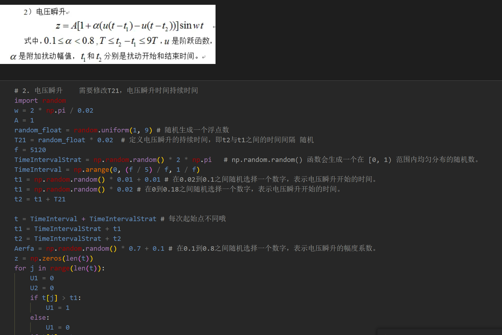
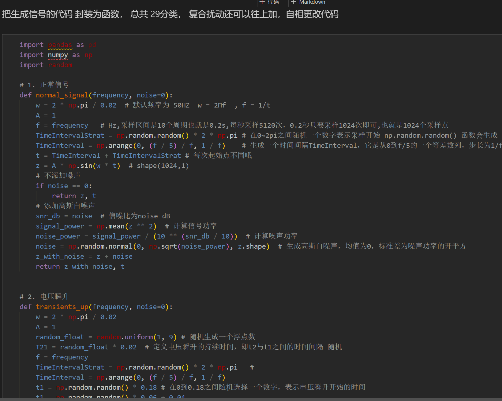
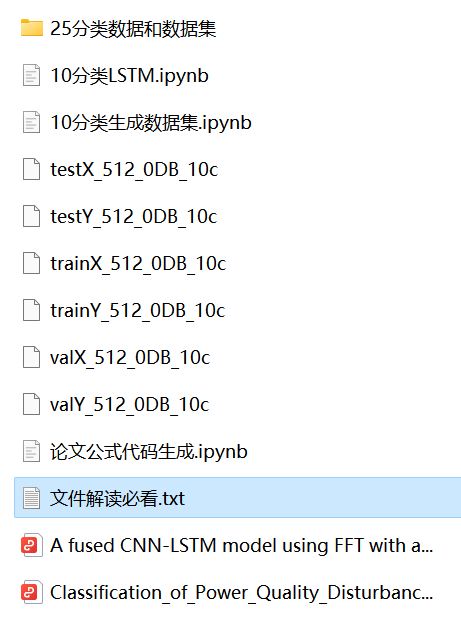

# Python-Electric Power Quality Disturbance Signal Dataset Generation and Classification

Includes code, literature, and file interpretation!
Including the Python implementation of complete 28 types of single disturbance and compound disturbance data formulas, as well as a pre-generated signal dataset. The corresponding codes can be run (With the introduced code, no matter how many types of compound signals are implemented, the code is detailed with comments).
Environment: Python 3.9
\n        \n      Detailed introduction to formulas
\n        \n  
\n        \n

## Images

<!-- PAYMENT_BLOCK -->

## Get this dataset

- Payment link (Stripe): [Buy now](https://buy.stripe.com/3cs8yP7sY87d0vu9AB)
- Payment QR code: 

<!-- /PAYMENT_BLOCK -->
